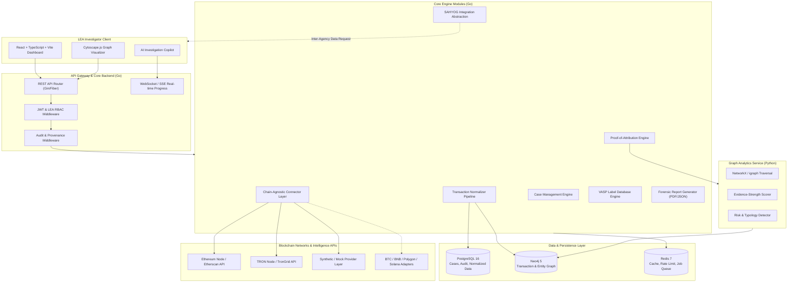

# TRACE-X: Explainable Cross-Chain VASP Attribution & Investigation Engine
## System Architecture & Technical Specifications

> **Problem Statement**: SIH 26182 — Automated Attribution of Unknown Cryptocurrency Wallets to Nearest Virtual Asset Service Providers (VASPs) through Blockchain Intelligence APIs.  
> **Target Audience**: Law Enforcement Agencies (LEAs), Financial Intelligence Units (FIUs), and Cyber Crime Investigators.

---

## 1. Executive Summary & Legal Compliance Guardrails

**TRACE-X** is an investigator-centric blockchain intelligence platform designed to trace cross-chain illicit cryptocurrency flows, reconstruct multi-hop transaction graphs, identify candidate Virtual Asset Service Providers (VASPs) closest to suspect wallets, compute explainable evidence-strength scores, and generate court-admissible forensic reports.

### 🛡️ Lawful Law-Enforcement Operational Guardrails
- **Read-Only / Non-Custodial Intelligence**: TRACE-X functions strictly as an analytical intelligence engine.
- **Zero Private-Key Interaction**: The platform contains **no capabilities** for private key access, wallet authorization, signature creation, fund transfers, asset freezing, or trading execution.
- **Audit Provenance**: Every query, report export, and graph traversal is timestamped and recorded in an immutable audit trail for legal chain-of-custody verification.

---

## 2. Architecture Diagram



---

## 3. Technology Stack & Key Dependencies

| Layer | Component | Selection & Rationale |
| :--- | :--- | :--- |
| **Frontend** | Framework | **React 18 + TypeScript + Vite** for high-speed rendering & type safety |
| | Styling & UI | **Tailwind CSS + shadcn/ui** (Dark LEA Cyber Theme) |
| | Graph Engine | **Cytoscape.js** (Canvas rendering, custom layout algorithms, expand/collapse nodes) |
| **Backend** | API Engine | **Go 1.22+** (Goroutine concurrency for high-throughput multi-hop tx tracing) |
| | Communication | **REST (JSON) + Server-Sent Events (SSE)** for streaming analysis progress |
| **Analytics Service** | Service | **Python 3.11+ (FastAPI)** with **NetworkX / igraph / NumPy / scikit-learn** |
| **Data Layer** | Relational DB | **PostgreSQL 16** (Case data, user accounts, audit logs, normalized records) |
| | Graph DB | **Neo4j 5** (Multi-hop path traversals, peel chain detection, graph queries via Cypher) |
| | Caching & State | **Redis 7** (Connector caching, job execution state, WebSocket session pub/sub) |
| **Infrastructure** | Containerization | **Docker & Docker Compose** for local and production deployment |

---

## 4. Chain-Agnostic Abstraction Layer

To ensure support for initial chains (**Ethereum** and **TRON**) while enabling future expansion to **Bitcoin, BNB Chain, Polygon, and Solana**, TRACE-X uses a unified Go interface:

```go
type BlockchainConnector interface {
    GetChainID() string
    GetAddressMetadata(ctx context.Context, address string) (*AddressMetadata, error)
    GetTransactions(ctx context.Context, address string, fromBlock, toBlock uint64) ([]NormalizedTransaction, error)
    GetTokenTransfers(ctx context.Context, address string) ([]NormalizedTokenTransfer, error)
    IsContract(ctx context.Context, address string) (bool, error)
}
```

---

## 5. Proof-of-Attribution & Evidence-Strength Scoring Engine

### ⚠️ Strict Attribution Methodology Guardrails
TRACE-X **never** claims a wallet is directly owned by a VASP simply because funds reached a VASP-associated address. It explicitly categorizes attributions into 4 distinct confidence tiers:

1. **`VERIFIED_LABEL`**: Address is officially documented/confirmed as a deposit, withdrawal, cold, or hot wallet of a specific VASP.
2. **`STRONG_ASSOCIATION`**: Direct 1-hop deposit/withdrawal flow with high volume, recurring transaction history, or known wallet cluster identity.
3. **`INFERRED_ASSOCIATION`**: Multi-hop path ($\le N$ hops) matching known deposit behavior, peel chains, or intermediary pass-through pattern.
4. **`UNKNOWN`**: Unlabeled wallet or decentralized pool without sufficient heuristic indicators.

### 📊 Evidence-Strength Score ($S$) Calculation Framework

$$S = \min\left(100, \left( W_{\text{hop}} \times S_{\text{hop}} + W_{\text{flow}} \times S_{\text{flow}} + W_{\text{temp}} \times S_{\text{temp}} + W_{\text{cluster}} \times S_{\text{cluster}} \right) \times (1 - U)\right)$$

Where:
- $S_{\text{hop}}$: Hop distance decay score (100% for 1-hop, decreasing exponentially per additional hop).
- $S_{\text{flow}}$: Proportion of total suspect wallet volume routed to the VASP.
- $S_{\text{temp}}$: Recency & velocity of transactions.
- $S_{\text{cluster}}$: Direct co-spending or multi-input heuristics score.
- $U$: Uncertainty metric based on mixing activity or high fan-out addresses encountered on the path.

### 📝 Mandated Attribution Result Record Schema
Every attribution produced by TRACE-X contains:
- **VASP / Entity Name & Category**
- **Evidence Type** (`VERIFIED_LABEL`, `STRONG_ASSOCIATION`, etc.)
- **Transaction Hashes Path**
- **Hop Distance**
- **Value & Token Flow (USD equivalent & native units)**
- **Timestamps (First & Last Transfer)**
- **Data Source** (Provider name or intelligence database version)
- **Evidence Strength Score** (0–100%)
- **Uncertainty Score** (0–100%)
- **Analysis Engine Version**

---

## 6. Core System Modules

1. **Case Management**: Investigators create cases, assign suspect wallets, tag evidence, and manage investigation lifecycles.
2. **Wallet Investigation**: Interactive workflow to initiate multi-chain searches, set hop limits, filter date ranges, and view progress.
3. **Blockchain Data Connectors**: Connectors for Ethereum (Etherscan/RPC) and TRON (TronGrid/RPC), with synthetic provider fallback.
4. **Transaction Normalization**: Unifies heterogeneous ETH, TRC-20, ERC-20, and native transactions into a standardized model.
5. **Transaction Graph Engine**: Ingests normalized transactions into Neo4j; queries for shortest paths, degree centrality, and flow subgraphs.
6. **VASP Intelligence Database**: High-performance repository of verified VASP deposit addresses, hot/cold labels, exchange names, and risk ratings.
7. **Proof-of-Attribution Engine**: Implements the multi-factor attribution algorithm and candidate VASP ranking.
8. **Evidence-Strength Scoring**: Calculates explainable score and uncertainty metrics.
9. **Risk & Typology Detection**: Identifies laundering patterns (Peel Chains, Layering, Structuring/Smurfing, High-Volume Pass-Through, Mixer interaction).
10. **Cross-Chain Intelligence Abstraction**: Unified interface mapping cross-chain hops (e.g. bridge transactions or cross-chain swaps).
11. **Investigation Copilot**: AI-assisted investigation summarizer generating narrative insights from transaction graphs.
12. **Report Generator**: Exports court-ready PDF and JSON evidence packages complete with cryptographic hash verification.
13. **Audit / Evidence Provenance**: Read-only law-enforcement chain of custody tracking every query and report export.
14. **SAHYOG Integration Abstraction Layer**: Standardized API interface for inter-agency data sharing with Indian LEA frameworks.

---

## 7. Development & Demo Strategy (Synthetic Provider Layer)

To ensure smooth local testing and demo execution without hitting API rate limits or requiring live mainnet keys:
- **Synthetic Data Provider**: Generates realistic, reproducible synthetic transaction graphs containing realistic suspect wallets, multi-hop laundering chains, peel chains, and labelled VASP deposit addresses for Binance, WazirX, CoinDCX, Kraken, and illicit entities.
- Toggle controlled via `.env` parameter: `USE_SYNTHETIC_DATA=true`.
